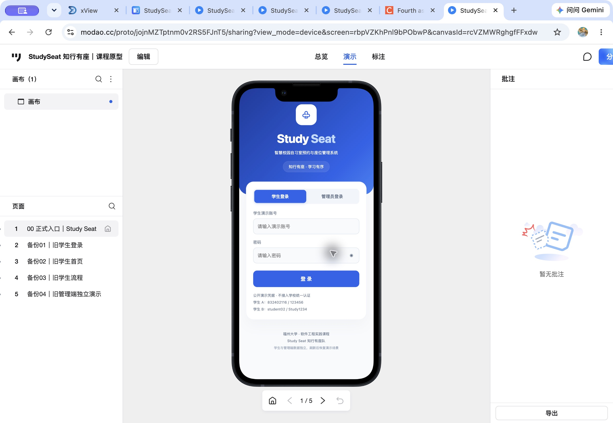

# Study Seat 墨刀原型搭建与维护说明

版本日期：2026-10-29。本文替代旧搭建指南、旧 AI 提示词、旧版使用/交付说明与旧博客原型稿，不再采用旧版逐页生成与导入流程。

## 1. 正式入口与账号

[Study Seat 在线交互原型](https://modao.cc/proto/jojnMZTptnm0v2RS5FJnT5/sharing?view_mode=device&screen=rbpVZKhPnl9bPObwP&canvasId=rcVZMWRghgfFFxdw)

正式起始页：**00 正式入口｜Study Seat**。未登录墨刀平台也能访问。页面右上角的墨刀平台“登录”不是原型的账号登录，演示时使用原型内部表单。推荐 Chrome。

| 身份 | 账号 | 密码 |
| --- | --- | --- |
| 学生 A | 832402116 | 123456 |
| 学生 B | student02 | Study1234 |
| 管理员 | admin01 | Admin1234 |

均为公开模拟凭据，不接入学校统一认证。

## 2. 当前墨刀工程实际结构

当前正式页面是一个 **375×812** 的手机原型视口，页面内的代码组件承载完整交互。组件内部有统一登录宿主、学生端业务视图和管理端业务视图。学生与管理视图各自保留模拟状态，由宿主提供顶部返回、工具和退出。

这意味着：功能视图数量不等于墨刀页面目录中的页面数量；界面不是全部由墨刀原生控件逐项绘制。应如实说明“墨刀承载可执行交互代码组件”，不声称纯手工原生搭建。

| 层级 | 当前内容 |
| --- | --- |
| 登录宿主 | 默认学生登录；管理员独立表单；密码显示/隐藏；角色切换与校验 |
| 学生功能视图 | 首页、选座、确认预约、我的预约、个人中心，以及签到/暂离/返回/结束等状态 |
| 管理功能视图 | 规则配置与开放时段、资源关闭管理、预约记录与操作日志，以及影响预览和各类详情 |
| 全局导航 | 业务页顶部退出；子页返回；学生工具；未保存编辑保护 |

线上目录仍保留“备份01｜旧学生登录”“备份02｜旧学生首页”“备份03｜旧学生流程”“备份04｜旧管理端独立演示”，它们用于历史回退，不作为正式演示路径。本轮文档整理不修改或删除这些线上页面。

## 3. 当前交互约定

- 学生登录进入首页；管理员登录进入规则配置。退出后回到统一登录入口，清空密码和角色导航历史。
- 选座确认页返回保留房间、日期、时段和座位。成功回执关闭后进入我的预约，避免回到可重复提交状态。
- 选座标题左侧重复的圆形返回箭头已移除，使用顶部统一返回按钮。
- 管理端修改规则后，离开/退出提示处理未保存输入。保存后形成版本；已有管理预约保留创建时快照。
- 资源关闭先预览影响，再确认。待签到记录可被取消；使用中、暂离中预约阻断关闭并提示现场处理。关联预约返回原关闭详情，影响预览返回保留表单。
- 重新开放解除关闭限制；已取消记录不会自动恢复，日志保留。通知仅为内容预览，不实际发送。
- **学生与管理端业务数据独立。** 管理端关闭资源不会取消学生端模拟预约。
- **同一次打开内退出重登保留数据；刷新或重新打开恢复初始场景。** 不提供跨标签、跨设备持久化。
- 初始学生时钟为北京时间 2026-10-28 13:50，随实际秒数推进；初始草稿 A101 / A08 / 14:00–16:00。长时间演示后应选择未来时段，或在工具中调整时钟。

## 4. 定版备份及恢复方式

独立 HTML 备份：[StudySeat_定版原型.html](../modao/StudySeat_定版原型.html)。这是定版代码组件备份，**不是墨刀原生工程文件**。

如将来确需在另一个有编辑权限的墨刀项目中复现，可按下列方式操作。当前工程已定版，不需要重复导入。

1. 新建 375×812 页面；使用墨刀提供的 HTML 导入/代码组件编辑功能，导入或粘贴备份中的完整 HTML。
2. 将组件放入页面，位置设为页面内 X=0、Y=0，宽 375、高 812；页面顶部/底部固定区域设为 0，避免与组件自带导航冲突。
3. 将该页命名为“00 正式入口｜Study Seat”，设为正式起始入口。
4. 在演示中分别检查学生和管理员登录、返回、退出，以及退出重登保留数据。不能只检查编辑画布。
5. 分享演示链接后，用未登录墨刀的窗口验证访问；博客和 PPT 应使用分享链接，不能使用编辑链接或本机地址。

墨刀界面上的操作名称可能随平台更新变化，应使用当时实际提供的 HTML/代码组件入口。没有编辑权限时，分享演示权限不等于能够修改项目。

## 5. 本地代码与墨刀的对应关系

| 文件 | 用途 |
| --- | --- |
| `deploy/assets/js/studyseat-prototype.js` | 统一登录、角色切换、全局导航 |
| `prototype/unified-student-runtime.js` | 学生会话、草稿、导航来源、内存状态 |
| `prototype/student/` 与 `prototype/student-app.js` | 学生界面与业务适配 |
| `prototype/admin-ui.js`、`prototype/admin.css` | 管理视图与样式 |
| `prototype/unified-admin-bridge.js` | 管理导航、来源返回、登录与退出保护 |
| `deploy/assets/js/studyseat-domain.js` | 学生业务模型 |
| `deploy/assets/js/studyseat-admin-model.js` | 独立管理业务模型 |
| `scripts/build-prototype.py` | 生成本地静态交互内容及资源版本号 |

本地 `deploy/` 通过相同核心交互提供演示；浏览器外部增加居中展示框，并额外修复内嵌加载时个人中心图表尺寸未就绪的问题。线上墨刀保持用户确认的定版状态。

本地维护流程：修改相应源文件 → 运行 `python3 scripts/build-prototype.py` → 运行 `node --test tests/*.test.cjs` → 按 [演示与提交说明](演示与提交说明.md) 实际验收。生成文件 `studyseat-frames.js` 不应手工修改。

生成脚本只更新本地静态文件，**不会自动更新墨刀项目或此独立 HTML 备份**。若未来重新定版，须同步更新代码组件备份和文档；不要直接把引用外部资源的本地 `deploy/login.html` 当成可独立导入的墨刀 HTML。

## 6. 实际截图与验收

本地测试和浏览器验收见 [同步记录](墨刀同步记录.md)；当前设计范围见 [原型设计说明](原型设计说明.md)。本原型没有真实后端、真实扫码设备、现场核验、实际推送或服务端并发保障。
